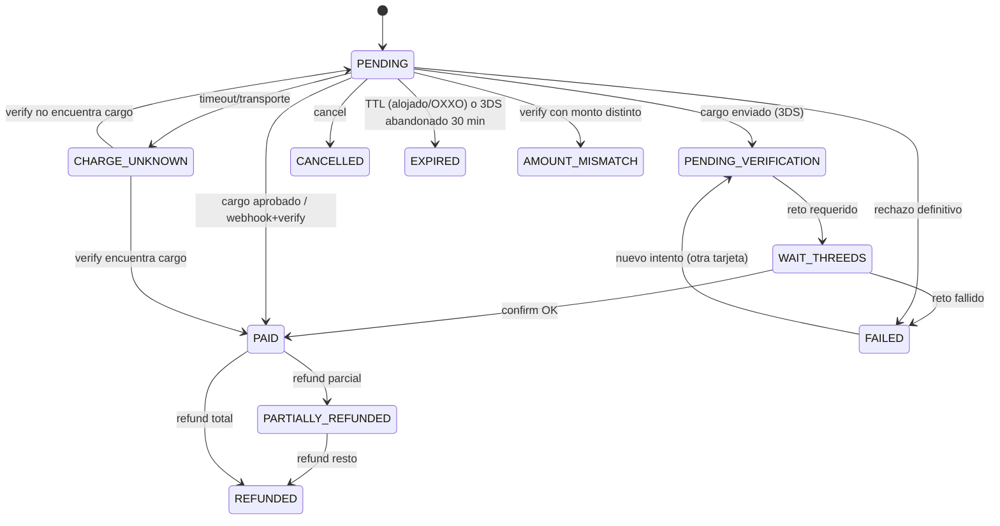

# 03 — Diseño

## 1. Outbox transaccional y entrega de eventos (EVT-003…011)

```
cambio de estado (tx) ──► UPDATE payment_order
                     └──► INSERT payment_event_outbox (eventId, orderId, sequence, type, payload JSONB, occurredAt)
                                         │ (commit atómico)
dispatcher (cada 2 s, SKIP LOCKED, round-robin por tenant)
   └─► por endpoint suscrito: INSERT delivery (eventId, endpointId) ON CONFLICT DO NOTHING
        └─► POST firmado (snapshot del payload) → 2xx: DELIVERED · otro/timeout: reintento con backoff
```

- **Tabla nueva `payment_event_outbox`** en el esquema del tenant: `(id uuid pk, order_id, sequence int, event_type, payload jsonb, occurred_at, dispatched_at null)`. Índice `(dispatched_at nulls first, occurred_at)`. Los `sequence` son monotónicos por orden, se asignan con `UPDATE payment_order SET event_sequence = event_sequence + 1 RETURNING`.
- **`payment-events.ts`** deja de usar `void enqueue`. Recibe el `tx` de Prisma y escribe en el outbox.
- **Dispatcher:**
  - Lee el outbox con `FOR UPDATE SKIP LOCKED LIMIT n` por tenant, iterando todos los tenants activos en round-robin. El cursor de tenants vive en memoria y se reinicia en cada arranque.
  - Concurrencia: `p-limit(8)`.
  - Timeout por entrega de 8 s, pero ya no bloquea a los demás.
- **Calendario de reintentos:** 1 s, 5 s, 30 s, 2 min, 10 min, 30 min, 1 h, 1 h… hasta 24 h, luego DEAD. Configurable con `OUTBOUND_WEBHOOK_MAX_AGE_HOURS=24`.
- **UrlGuard (EVT-001):**
  - `resolveAll()` devuelve todas las direcciones. Cada una pasa por `isBlockedAddress` y la allowlist; si alguna está bloqueada, se rechaza la URL.
  - Se elige una dirección (IPv4 primero) y se conecta con `lookup` fijado. SNI y Host salen del hostname.
  - Si la conexión falla, se prueba la siguiente dirección validada.
  - Se revalida en cada entrega. Así se conserva la defensa contra DNS rebinding, porque nunca se conecta a una IP no validada.
  - *Descartado:* conservar la regla de una sola IP, que bloquea todo PaaS o CDN. También descartado: allowlist manual por hostname como único mecanismo, que no escala; queda como opción adicional por tenant.
- **Transporte (EVT-009):** se construye la URL desde `new URL(subscribed)` conservando `search`. `https` solo es obligatorio si `requireHttps`.
- **Arranque:** `OUTBOUND_WEBHOOK_ENABLED` vale `true` por defecto. Si es `false` y hay endpoints activos, `/health/ready` reporta `degraded`.

## 2. Idempotencia (IDM-001…004)

- **Tabla `idempotency_record`** en el esquema del tenant: `(key, route, request_hash sha256, status IN_PROGRESS|DONE, response_status, response_body jsonb, created_at, expires_at)`. PK `(key, route)`.
- **Interceptor `IdempotencyInterceptor`**, aplicado a crear orden, cargar, confirmar y reembolsar:
  1. `INSERT … ON CONFLICT DO NOTHING` en estado IN_PROGRESS.
  2. Si ya existía con `DONE` y el mismo hash, devuelve la respuesta guardada.
  3. Si existía con otro hash, responde 422.
  4. Si existía con `IN_PROGRESS`, responde 409 con `Retry-After: 2`.
  5. Al terminar, pasa a DONE con la respuesta. Ante un error definitivo 4xx también guarda DONE con la respuesta. Ante 5xx o 504 deja IN_PROGRESS con TTL de 10 min, para que la conciliación resuelva el resultado y el reintento devuelva lo correcto.
- **Fallo de BD después del éxito en NetPay (IDM-004):** se escribe `pending_provider_result (order_id, operation, provider_payload, created_at)` con un insert separado y reintentable. La conciliación lo aplica. El claim de la orden no se libera mientras exista un pendiente.
- **Dedupe de entrada (IDM-005):** clave `sha256(eventType|transactionId|status)` con TTL de 10 min en una tabla `inbound_event_seen`.

## 3. Estados de la orden (PAY-001…005, REC-002/003)



- **Intentos:** tabla `payment_attempt (order_id, attempt_no, netpay_transaction_id, status, decline_code, created_at)`. La orden apunta al intento vigente, lo que elimina la guarda `netpayTransactionId:null` que impedía recobrar.
- **Cancelación:** `POST /orders/:id/cancel` solo procede desde PENDING, CHARGE_UNKNOWN (después de verificar) o FAILED. Si NetPay ofrece expirar sesión o referencia, se llama; si no, se marca CANCELLED. Un pago tardío detectado por la conciliación se registra como `LATE_PAYMENT_ON_CANCELLED` y el consumidor recibe el evento `payment.paid_after_cancel` para reembolsar.

## 4. Conciliación (REC-001…006)

- **Worker `ReconciliationService`:** `setInterval` con jitter, solo cuando `RECONCILE_ENABLED=true`, en cada instancia, con lock por orden mediante `pg_try_advisory_xact_lock`. Con min-instances 0 se ejecuta mientras haya tráfico.
- Para prod, además, se agrega un **Cloud Scheduler que llama a `POST /internal/reconcile`**, autenticado con OIDC de una service account dedicada. Esto garantiza que se ejecute aunque la instancia esté fría.
- **Selección por ciclo:**
  - Órdenes no terminales con `updated_at < now() - 5 min`.
  - Órdenes OXXO con referencia vencida.
  - Filas de `pending_provider_result`.
- **Límite:** 5 req/s a NetPay por tenant.
- **Métricas:** `reconcile_checked`, `reconcile_corrected{from,to}`, `reconcile_errors`.

## 5. Config versionada (CFG-002/003/004)

- `PaymentConfig` pasa a ser append-only, con `version` y `active`. La orden guarda `config_id`. Refund y verify cargan la config de la orden.
- **Cambio de ambiente o llave:** se crea una nueva versión con un nuevo `webhook_token`, `webhookRegisteredAt = null` y `drift = unknown`.
- **Drift:** `GET /t/payments/config/webhook` compara la URL registrada en NetPay con la esperada. `/health/ready` autenticado agrega `netpayWebhookDrift`. Se crea una métrica y una alerta.

## 6. Seguridad (SEC)

- **`RbacAuditService`:** al arrancar recorre los handlers. Si una ruta tiene `@RequirePermissions` y no tiene `@RequireScopes`, el arranque falla (SEC-001).
- **Nuevos scopes otorgables:** `webhooks:read` y `webhooks:write`.
- **Alta de usuario con API key:** la contraseña sale del DTO. El usuario se crea INVITED y recibe un token de invitación. El techo de rol es MEMBER (SEC-002).
- **Throttler:** se definen dos throttlers, `default` y `auth`. `auth` se aplica con `@Throttle({auth})` solo en sign-in y refresh. Health usa `@SkipThrottle({default:true, auth:true})`. En prod se usa `ThrottlerStorageRedisService`.
- **Logger:** un pino-like (JSON) con redacción del path `/payments/webhook/<redactado>`.
- **Keyring:** el formato del ciphertext es `v<n>:<base64(nonce|tag|body)>`. Se usan `PII_KEYS_JSON` y `NETPAY_KEYS_JSON` con `{current, keys{id:base64}}`. Un job `reencrypt` corre por lotes.

## 7. CI/CD y migraciones (OPS-001/002/006/007)

**Workflows:**
- `ci.yml` pasa a ser `workflow_call`.
- `deploy.yml` lleva `needs: [ci]`.
- Environment `production` con required reviewers y la rama `main` como única permitida.
- Protección de `main`: 1 revisión y los checks obligatorios.

**Migración de tenants**, en el job `netpay-migrate`:
1. Aplica primero el control-plane.
2. Para cada tenant ACTIVE, toma el lock advisory por esquema y aplica las versiones faltantes en orden.
3. Guarda `(version, checksum)` en `tenant_schema_migration`. Si el checksum no coincide, aborta.
4. Al terminar compara las versiones: todos los tenants deben quedar en `max(version)`.

**Promoción:** desplegar con `--no-traffic --tag rc-<sha>`, hacer smoke a `https://rc-<sha>---netpay-api-…run.app` y mover tráfico 10 → 50 → 100 con verificación de 5xx en Cloud Monitoring en cada paso. Si falla, se ejecuta `update-traffic --to-revisions=<prev>=100`.

## 7.1 Observabilidad (OPS-003/004/005)

- Canal de notificación (email o Slack) para las 3 políticas existentes, más uptime check y SLO.
- Métricas personalizadas vía log-based metrics sobre los logs JSON: `payment_status_change`, `netpay_latency_ms` y `outbound_delivery_result`. *Descartado:* OpenTelemetry en esta fase, por costo y complejidad; queda para P2.

## 8. Alternativas descartadas

| Decisión | Alternativa | Por qué no |
|---|---|---|
| Outbox en Postgres | Pub/Sub | Requiere una transacción distribuida o un outbox de todos modos; más costo y otro servicio |
| Interceptor de idempotencia en BD | Redis | La llave debe sobrevivir junto al estado de la orden; Postgres ya es transaccional |
| Conciliación con Cloud Scheduler + endpoint | Cron in-process solamente | Con min-instances 0 no correría sin tráfico |
| Pin de IP validada | Prohibir varias IP | Bloquea todo PaaS o CDN; el pin ya mitiga el rebinding |
